<!-- GitHub profile README | GitHub-compatible gradients are embedded in local SVG assets. No external CSS, scripts, fabricated metrics, or private repository links. -->

<table width="100%">
<tr>
<td align="left" valign="middle" width="32%"><a href="#top">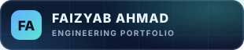</a></td>
<td align="right" valign="middle"><a href="#top"><strong>Home</strong></a> &nbsp;·&nbsp; <a href="#services"><strong>Services</strong></a> &nbsp;·&nbsp; <a href="#projects"><strong>Projects</strong></a> &nbsp;·&nbsp; <a href="#faqs"><strong>FAQs</strong></a> &nbsp;·&nbsp; <a href="#contact"><strong>Contact</strong></a> &nbsp;·&nbsp; <a href="#conclusion"><strong>Conclusion</strong></a></td>
</tr>
</table>

<!-- HERO -->

<strong>Software Engineer · Technical Project Coordinator</strong> &nbsp;|&nbsp; BS Computer Science (2026), University of Central Punjab

Frontend development, UI/UX design, and project delivery—from client requirements and implementation to QA review and handoff.

<a href="https://www.linkedin.com/in/faizyab-a-4b3309372/">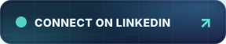</a>

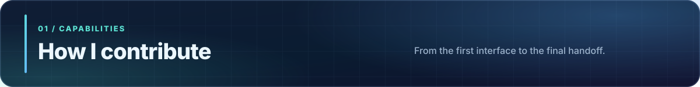

<table width="100%"><tr>
<td width="50%" valign="top">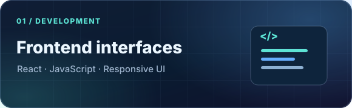
I implement responsive, design-conscious frontend screens and reusable React interfaces.
</td>
<td width="50%" valign="top">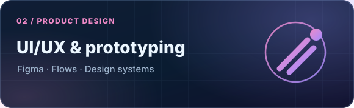
I create Figma concepts, user flows, high-fidelity prototypes, and interface systems for handoff.
</td>
</tr><tr>
<td width="50%" valign="top">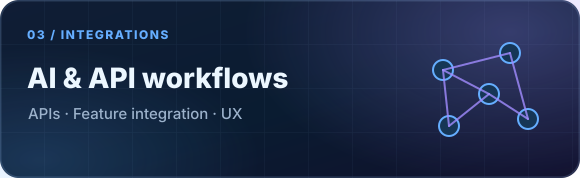
I work with API-based features and coordinate AI-powered application requirements and integrations.
</td>
<td width="50%" valign="top">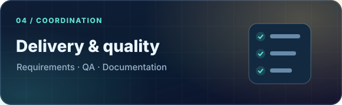
I translate requirements into tasks, coordinate delivery, review functionality, and document handoffs.
</td>
</tr></table>

<strong>Explore my technical toolkit</strong>

| Area | Skills and tools |
| --- | --- |
| **Frontend** | React.js, JavaScript, HTML, CSS, Tailwind CSS, Bootstrap 5 |
| **Backend & APIs** | Python, FastAPI, PHP, REST APIs, JWT / OTP authentication |
| **Data** | SQL |
| **AI & integrations** | OpenAI API, Hugging Face; coordination of external integrations |
| **Design** | Figma, responsive UI, prototyping, user flows |
| **Workflow & quality** | Git, GitHub, Postman, Vite, requirements, QA oversight, documentation |

### Selected client and university work

The work below differentiates **hands-on interface design/development** from **technical project coordination**. Where a stack is listed for a coordinated project, it describes team technology rather than a claim that I personally built every part.

<table width="100%">
<tr>
<td width="50%" valign="top">
  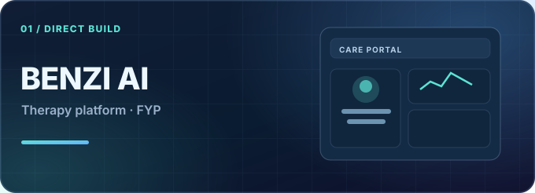
  
<strong>BENZI AI — Therapist &amp; Patient Care Platform</strong>

  
Direct contribution · UI/UX + React frontend · Jan 2026

  
Designed the UI/UX for patient, therapist, and administrator portals, including wireframes, reusable components, and design-system foundations. Personally developed the patient and therapist responsive frontend interfaces in React.js from Figma screens.

  
<strong>Tools / team stack:</strong> Figma · React.js

</td>
<td width="50%" valign="top">
  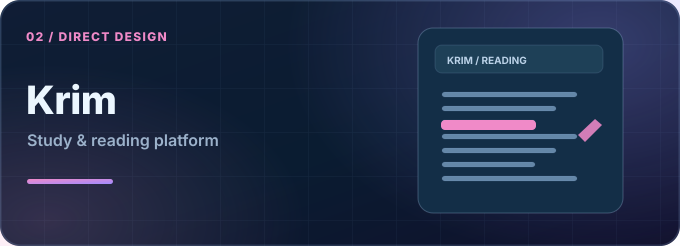
  
<strong>Krim Christian Study Platform</strong>

  
Direct contribution · UI/UX designer · Sep 2026

  
Created three alternative interface directions and high-fidelity Figma prototypes for the reading platform. Prepared core screens and flows for developer handoff.

  
<strong>Tools / team stack:</strong> Figma · High-fidelity prototyping

</td>
</tr>
</table>

<table width="100%">
<tr>
<td width="50%" valign="top">
  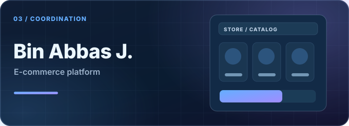
  
<strong>Bin Abbas J. Clone E-Commerce Platform</strong>

  
Project coordination · Jul–Aug 2026

  
Coordinated a two-month e-commerce delivery covering storefront, backend, admin panel, and checkout. Managed client discussions, assignments, progress tracking, and documentation; oversaw storefront and checkout QA supported by the team’s Playwright and Vitest coverage.

  
<strong>Tools / team stack:</strong> Project stack: Next.js · Team QA: Playwright, Vitest

</td>
<td width="50%" valign="top">
  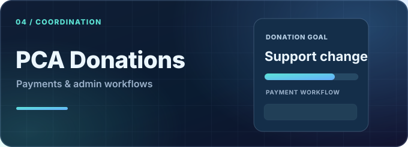
  
<strong>Pakistan Citizens Alliance (PCA) Donation Platform</strong>

  
Project coordination · Apr–Jun 2026

  
Coordinated expansion into a full-stack donation experience with backend development, payment integration, admin workflows, and additional pages. Managed integration requirements for PayFast, Cloudinary, and Nodemailer, plus QA and handoff documentation.

  
<strong>Tools / team stack:</strong> Project stack: Next.js · PostgreSQL · Prisma · Redux Toolkit · PayFast

</td>
</tr>
</table>

<table width="100%">
<tr>
<td width="50%" valign="top">
  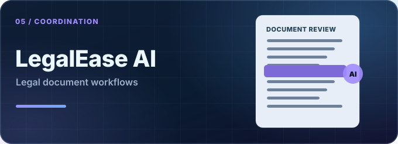
  
<strong>LegalEase AI — Legal-Document Assistant</strong>

  
Project coordination · Jun 2026

  
Coordinated requirements and documentation for clause classification, risk scoring, plain-English simplification, document drafting, and chatbot interaction. Also covered OCR ingestion and consultation-marketplace workflows.

  
<strong>Tools / team stack:</strong> Project stack: FastAPI · MongoDB · Hugging Face · OCR

</td>
<td width="50%" valign="top">
  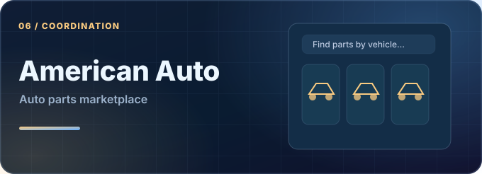
  
<strong>American Auto Salvage — US Auto Parts Marketplace</strong>

  
Project coordination · Feb–Apr 2026

  
Coordinated storefront and admin work and helped organize imports of more than 100,000 product listings. Supported catalog, vehicle-model, order, permissions, inquiry, and handoff workflows.

  
<strong>Tools / team stack:</strong> Project stack: React · Vite

</td>
</tr>
</table>

<table width="100%">
<tr>
<td width="50%" valign="top">
  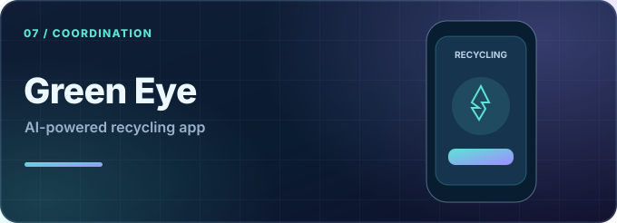
  
<strong>Green Eye — AI-Powered Recycling App</strong>

  
Project coordination · Jan–Feb 2026

  
Coordinated a one-month build spanning backend, admin dashboard, and Flutter mobile app. Managed requirements for vision-based recycling scans, location-aware center searches, contributions, and reviews.

  
<strong>Tools / team stack:</strong> Project stack: Node.js · Express · MongoDB · OpenAI · Flutter

</td>
<td width="50%" valign="top"></td>
</tr>
</table>

### Public GitHub repositories

These are actual public repository links from my previous README. Client work remains separate from public source code.

<table width="100%">
<tr>
<td width="50%" valign="top">
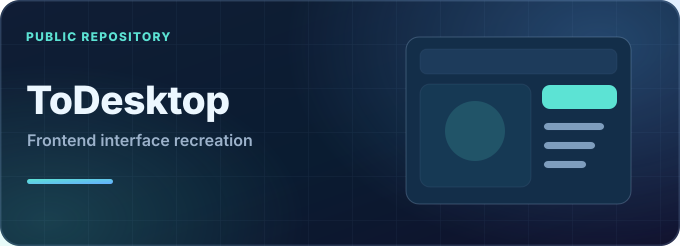

<strong>ToDesktop</strong> &nbsp; Frontend · UI recreation

Frontend practice project recreating a ToDesktop-inspired website interface.

<a href="https://github.com/FaizyabBajwa/ToDesktop"><strong>View repository →</strong></a>

</td>
<td width="50%" valign="top">
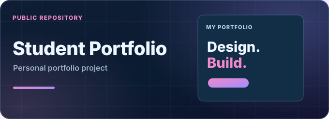

<strong>Student Portfolio</strong> &nbsp; Portfolio · Web design

A student portfolio website for presenting personal work and development projects.

<a href="https://github.com/FaizyabBajwa/student-portfolio"><strong>View repository →</strong></a>

</td>
</tr>
</table>

<table width="100%">
<tr>
<td width="50%" valign="top">
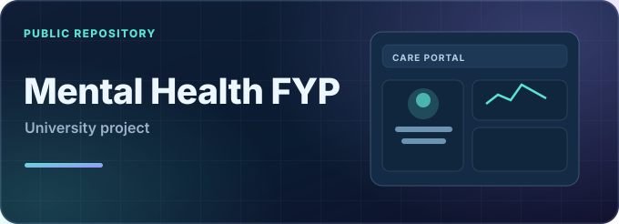

<strong>Mental Health FYP</strong> &nbsp; University work

University repository for a mental-health-related software concept.

<a href="https://github.com/FaizyabBajwa/Fyp-To-Reduce-Mental-Health"><strong>View repository →</strong></a>

</td>
<td width="50%" valign="top">
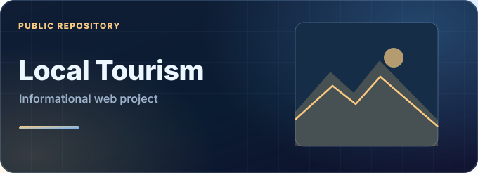

<strong>Local Tourism Website</strong> &nbsp; Web project

Information and presentation website centered on local tourism.

<a href="https://github.com/FaizyabBajwa/local-tourism-website"><strong>View repository →</strong></a>

</td>
</tr>
</table>

<a href="https://github.com/FaizyabBajwa?tab=repositories"><strong>Browse all public repositories →</strong></a>

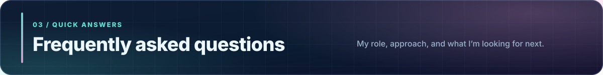

<strong>01. What kind of work do you focus on?</strong>

My focus is React frontend development, interface design in Figma, AI-related product workflows, and coordinating software delivery from requirements through QA and handoff.

<strong>02. Which project components did you personally design or develop?</strong>

For BENZI AI, I designed the UI/UX of three portals and developed the patient and therapist frontend interfaces using React.js. For Krim, I created three Figma design directions and high-fidelity prototypes. On the other client projects listed above, my primary role was technical coordination.

<strong>03. Are all project repositories public?</strong>

No. The four linked repositories are public GitHub work. Several commercial and client projects are described as case studies because their source repositories are private.

<strong>04. Have you worked with AI-powered applications?</strong>

Yes. I coordinated product workflows involving AI legal-document analysis in LegalEase AI and AI vision-based recycling features in Green Eye. My focus included understanding requirements, planning work with developers, and helping validate delivery.

<strong>05. How do you approach quality and project delivery?</strong>

I begin by clarifying expected behavior, turning requirements into actionable tasks, reviewing completed functionality, documenting issues, and coordinating follow-up. For Bin Abbas J., this included oversight of checkout and storefront quality checks supported by the team’s Playwright and Vitest coverage.

<strong>06. What opportunities are you open to?</strong>

I'm interested in junior software engineering and internship roles, frontend or UI/UX opportunities, and collaborations where thoughtful interfaces and reliable execution matter.

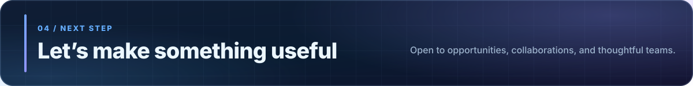

<a href="mailto:therealfaizyabahmad@gmail.com">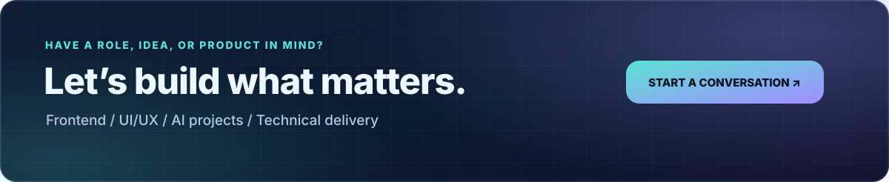</a>

<a href="mailto:therealfaizyabahmad@gmail.com">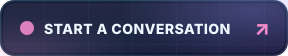</a>

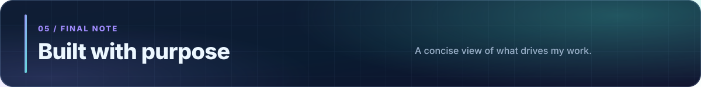

> **Good software starts with understanding the problem.** I aim to combine practical engineering, thoughtful product design, and clear team communication to deliver work that people can actually use.

Thank you for exploring my projects. You can view my work, read the case studies above, or get in touch to discuss an opportunity.

<a href="#top"><strong>↑ Back to the top</strong></a>

