<!-- Faizyab Ahmad | GitHub-compatible navy + teal developer portfolio -->


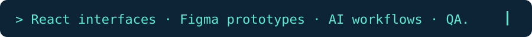

<strong>Software Engineer · Technical Project Coordinator</strong> BS Computer Science (2026) · University of Central Punjab

 &nbsp;
 &nbsp;
 &nbsp;

I work on <strong>React interfaces</strong>, <strong>UI/UX design</strong>, and <strong>software delivery</strong>—from understanding client requirements to coordinating development, testing, and handoff.

<!-- The navigation is made from entire clickable SVG pills, avoiding icon/text baseline differences. -->

<a href="#featured-projects">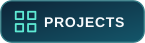</a>

<a href="#technical-toolkit">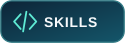</a>

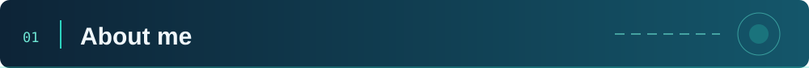
I'm Faizyab Ahmad, a Software Engineer and 2026 BS Computer Science graduate from the University of Central Punjab. My experience includes frontend development, UI/UX design, client communication, and technical project coordination.
Since January 2026, I have worked on independent client projects as a Technical Project Coordinator / Software Engineer. I gather requirements, organize development tasks, track progress, discuss feedback with clients, and support QA, documentation, and final delivery.
I also build user interfaces with React.js. For my BENZI AI final-year project, I designed the interfaces for three user portals and personally developed the responsive patient and therapist frontends. I value teamwork, clear communication, and solving practical problems.

<table width="100%">
<tr>
<td width="33%" align="center" valign="top">

<strong>BUILDING</strong> React.js · Responsive UI
</td>
<td width="34%" align="center" valign="top">

<strong>COORDINATING</strong> Client requirements · Delivery
</td>
<td width="33%" align="center" valign="top">

<strong>IMPROVING</strong> QA · Documentation
</td>
</tr>
</table>

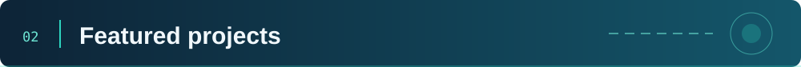
 These are my public GitHub repositories. My client projects and final-year project contributions are listed separately below.

<table width="100%">
<tr>
<td width="50%" valign="top">

 <strong>01 / ToDesktop</strong>

A frontend practice project recreating a ToDesktop-inspired website experience.

</td>
<td width="50%" valign="top">

 <strong>02 / Student Portfolio</strong>

A portfolio website project for presenting personal and development work.

</td>
</tr>
<tr>
<td width="50%" valign="top">

 <strong>03 / Mental Health FYP</strong>

A university repository focused on a mental-health-related software concept.

</td>
<td width="50%" valign="top">

 <strong>04 / Local Tourism Website</strong>

A website project built around local tourism information and presentation.

</td>
</tr>
</table>

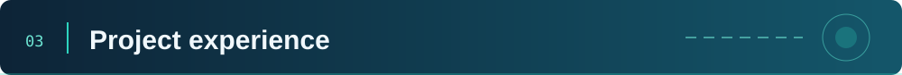
The following projects are listed in my resume. I distinguish the work I personally designed or developed from projects where I coordinated tasks, requirements, testing, and delivery. These are not presented as public repositories.

<table width="100%">
<tr>
<td width="28%" valign="top">

<strong>BENZI AI</strong> UI/UX · React.js · Figma
</td>
<td valign="top">
<strong>Therapist &amp; Patient Care Platform</strong>

Designed the UI/UX for three portals—patient, therapist, and admin—including wireframes, user flows, reusable components, and a shared design system. I personally built the patient and therapist frontend interfaces in React.js from Figma designs.

 
</td>
</tr>
<tr>
<td width="28%" valign="top">

<strong>LegalEase AI</strong> Project coordination
</td>
<td valign="top">
<strong>Legal-Document Assistant</strong>

Coordinated requirements and documentation for an AI legal-document assistant with clause classification, risk scoring, plain-English explanations, document drafting, and chatbot features. I also coordinated requirements for OCR-based document uploads and lawyer-consultation features. The project used FastAPI, MongoDB, Hugging Face, and OCR.

 
</td>
</tr>
<tr>
<td width="28%" valign="top">

<strong>PCA Donation Platform</strong> Project coordination
</td>
<td valign="top">
<strong>Full-Stack Donation System</strong>

Coordinated a multi-phase upgrade from a frontend project to a full-stack donation platform. I worked with the development team on requirements for PayFast payments, Cloudinary uploads, and Nodemailer emails, and supported dashboard improvements, QA, documentation, and client handoff. The project used Next.js, PostgreSQL, Prisma, and Redux Toolkit.

  
</td>
</tr>
</table>

<strong>More projects from my resume</strong>

<table width="100%">
<tr><td valign="top" width="28%"><strong>Krim Christian Study Platform</strong> Sep 2026 · UI/UX design</td><td>Created three different interface designs and high-fidelity Figma prototypes for a Christian study and reading platform, giving the client options for its core screens and user flows.</td></tr>
<tr><td valign="top"><strong>Bin Abbas J. E-Commerce Platform</strong> Jul–Aug 2026 · Project coordination</td><td>Coordinated development work across the storefront, backend, database, admin panel, and checkout. Followed project progress and oversaw QA of key shopping workflows using the team's Playwright and Vitest tests.</td></tr>
<tr><td valign="top"><strong>American Auto Salvage</strong> Feb–Apr 2026 · Project coordination</td><td>Coordinated work on an auto-parts storefront and admin system, including organizing more than 100,000 product listings, order workflows, access permissions, and handoff documentation.</td></tr>
<tr><td valign="top"><strong>Green Eye Recycling App</strong> Jan–Feb 2026 · Project coordination</td><td>Coordinated requirements for an AI-powered recycling platform spanning a backend, admin dashboard, and Flutter app. The project included OpenAI Vision recycling scans and recycling-center search.</td></tr>
</table>

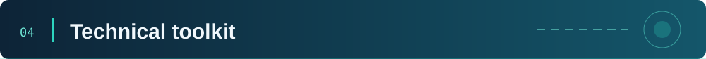

<table width="100%">
<tr>
<td width="50%" valign="top">

 <strong>Frontend</strong>

React.js · JavaScript · HTML · CSS Tailwind CSS · Bootstrap 5

</td>
<td width="50%" valign="top">

 <strong>Backend &amp; APIs</strong>

Python · FastAPI · PHP REST APIs · JWT / OTP authentication

</td>
</tr>
<tr>
<td width="50%" valign="top">

 <strong>Data</strong>

SQL

</td>
<td width="50%" valign="top">

 <strong>AI &amp; integrations</strong>

   
</td>
</tr>
<tr>
<td width="50%" valign="top">

 <strong>UI/UX design</strong>

Figma · Prototyping Responsive interface design

</td>
<td width="50%" valign="top">

 <strong>Tools &amp; delivery</strong>

Requirements gathering · Client communication Technical documentation · QA oversight · Handoff

</td>
</tr>
</table>

The skills above come from my resume. Technology badges on coordinated projects describe the project stack, not a claim that I personally developed every component.

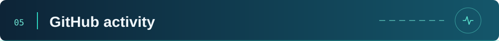
 My public repositories and contribution history are available on <a href="https://github.com/FaizyabBajwa?tab=overview"><strong>GitHub → View my activity</strong></a>.

<strong>View live GitHub statistics</strong> — third-party cards

These are third-party displays of real public data and may be temporarily unavailable. GitHub's own contribution calendar remains the authoritative source.

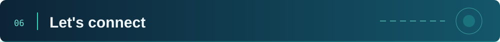
 I'm open to junior software engineering roles, internship opportunities, and collaborations in frontend development, UI/UX design, and software projects. Feel free to contact me.

<a href="#top">↑ Back to top</a>

