
 
Software Engineer   ·   Design-minded Developer   ·   Curious Builder

Turning ideas into meaningful digital experiences.

About me · Selected projects · Technical toolkit · Activity · Connect

About me
I'm Faizyab Ahmad, a software engineer and BS Computer Science graduate (2026) from the University of Central Punjab. My work sits at the intersection of thoughtful interface design, practical engineering, and clear communication.

I build responsive frontend experiences, work with modern web technologies and AI integrations, and coordinate software delivery from requirements through testing and handoff. I care about clean interactions, useful products, and the small details that make an application feel reliable.

  

Currently focused on: Full-stack engineering · UI/UX systems · AI-assisted applications · Software quality and testing.

Selected projects
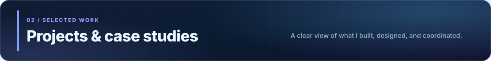
A selection of my public repositories and documented project experience. Decorative project illustrations below are custom SVG artwork, not application screenshots.

Public repositories
<a href="https://github.com/FaizyabBajwa/ToDesktop">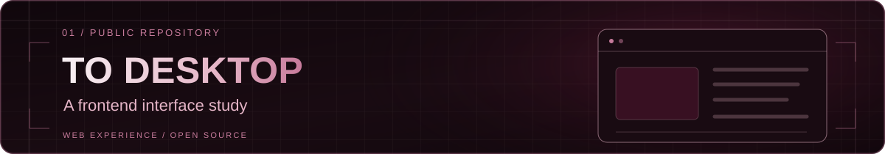</a>

A frontend development project based around a ToDesktop-style web experience. Explore source ↗

<a href="https://github.com/FaizyabBajwa/student-portfolio">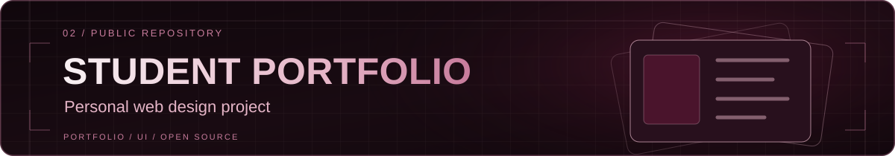</a>

A personal portfolio-oriented web project. Explore source ↗

<a href="https://github.com/FaizyabBajwa/Fyp-To-Reduce-Mental-Health"></a>

A university-project repository exploring a mental-health-related digital concept. Explore source ↗

<a href="https://github.com/FaizyabBajwa/local-tourism-website"></a>

A web project exploring a local tourism theme. Explore source ↗

Selected project experience
The following projects are included from my documented professional and academic work; they are not presented as public GitHub repositories.

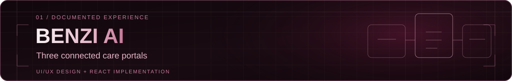
BENZI AI — Therapist & Patient Care Platform
Final-year project · Figma · React.js
Designed UI/UX for patient, therapist, and admin portals; personally developed responsive patient and therapist frontend interfaces from Figma designs.

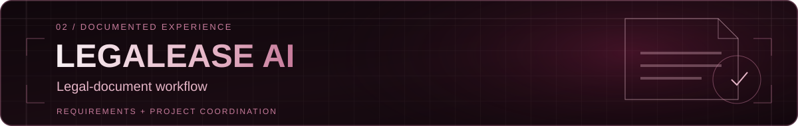
LegalEase AI — Legal-Document Assistant
Project coordination · FastAPI · MongoDB · Hugging Face · OCR
Coordinated documentation and development requirements for an AI-assisted legal-document workflow, including document analysis and OCR ingestion.

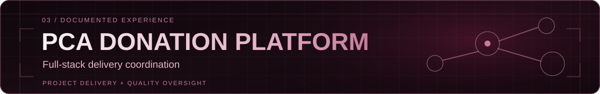
Pakistan Citizens Alliance — Donation Platform
Project coordination · Next.js · PostgreSQL · Prisma · PayFast
Coordinated a multi-phase full-stack expansion, including payment and email integration requirements, dashboard improvements, QA, and handoff.

Technical toolkit
 
Frontend: React.js · JavaScript · HTML5 · CSS3 · Tailwind CSS · Bootstrap 5
Backend & APIs: Python · FastAPI · PHP · REST APIs · JWT / OTP authentication

Data: SQL
AI & integrations: OpenAI APIs · Hugging Face · PayFast · Nodemailer

Design: Figma · UI/UX · Prototyping · Responsive UI design
Workflow: Git · GitHub · Vite · Postman · Requirements gathering · Documentation · QA coordination

GitHub activity
My public contributions and repositories are available directly on GitHub. The activity calendar is maintained by GitHub; this profile deliberately avoids invented totals, streaks or decorative graphs presented as real data.

View my GitHub contribution calendar and repositories ↗

Let's connect
I'm interested in conversations about meaningful web experiences, thoughtful product interfaces, full-stack engineering, and software quality.

 <a href="https://github.com/FaizyabBajwa">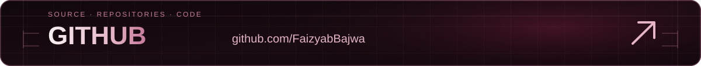</a> <a href="https://www.linkedin.com/in/faizyab-a-4b3309372/">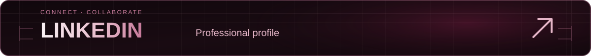</a> <a href="mailto:therealfaizyabahmad@gmail.com">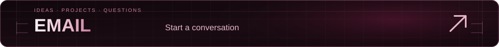</a> 

  

