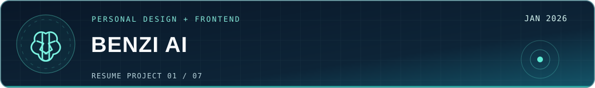
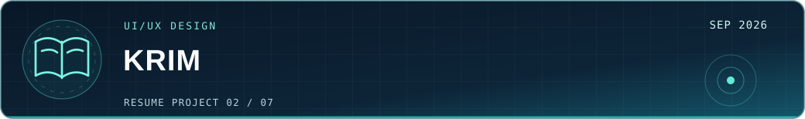
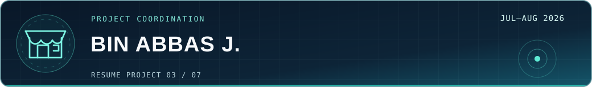
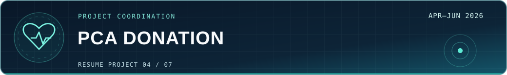
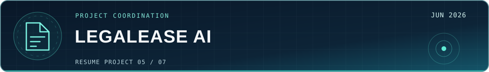
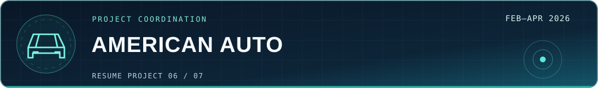
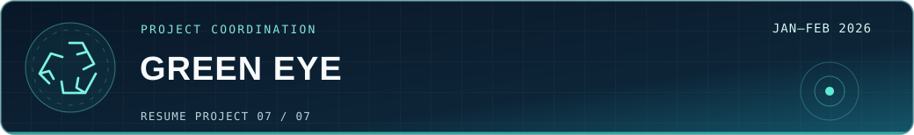

<!-- Faizyab Ahmad | Navy + teal portfolio | All seven resume projects featured; no private code or phone number -->

<strong>Software Engineer · Technical Project Coordinator</strong> BS Computer Science (2026) · University of Central Punjab

 &nbsp;
 &nbsp;
 &nbsp;

I work on <strong>React interfaces</strong>, <strong>UI/UX design</strong>, and <strong>software delivery</strong>—from understanding client requirements to coordinating development, testing, and handoff.

<!-- The navigation is made from entire clickable SVG pills, avoiding icon/text baseline differences. -->

I'm Faizyab Ahmad, a Software Engineer and 2026 BS Computer Science graduate from the University of Central Punjab. My experience includes frontend development, UI/UX design, client communication, and technical project coordination.
Since January 2026, I have worked on independent client projects as a Technical Project Coordinator / Software Engineer. I gather requirements, translate them into technical tasks, coordinate small development teams, review progress with clients, and prepare QA and handoff documentation.
I also design interfaces in Figma and develop responsive frontends using React.js. My seven selected resume projects below demonstrate both hands-on design/development contributions and project coordination across web, mobile, and AI-related products.

<table width="100%">
<tr>
<td width="33%" align="center" valign="top">

<strong>BUILDING</strong> React.js · Responsive UI
</td>
<td width="34%" align="center" valign="top">

<strong>COORDINATING</strong> Client requirements · Delivery
</td>
<td width="33%" align="center" valign="top">

<strong>IMPROVING</strong> QA · Documentation
</td>
</tr>
</table>

 These are my public GitHub repositories. My client projects and final-year project contributions are listed separately below.

<table width="100%">
<tr>
<td width="50%" valign="top">

 <strong>01 / ToDesktop</strong>

A frontend practice project recreating a ToDesktop-inspired website experience.

</td>
<td width="50%" valign="top">

 <strong>02 / Student Portfolio</strong>

A portfolio website project for presenting personal and development work.

</td>
</tr>
<tr>
<td width="50%" valign="top">

 <strong>03 / Mental Health FYP</strong>

A university repository focused on a mental-health-related software concept.

</td>
<td width="50%" valign="top">

 <strong>04 / Local Tourism Website</strong>

A website project built around local tourism information and presentation.

</td>
</tr>
</table>

Seven selected projects from my resume, including direct UI/UX and frontend development as well as software project coordination. These project summaries are based on my documented responsibilities; they are not being presented as public source repositories.

<strong>Design &amp; frontend implementation:</strong> BENZI AI and Krim &nbsp;·&nbsp; <strong>Project coordination:</strong> Bin Abbas J., PCA, LegalEase AI, American Auto Salvage, and Green Eye

<table width="100%">
<tr><td valign="top">

<strong>BENZI AI — Therapist &amp; Patient Care Platform</strong> Final-year project · Direct UI/UX design and frontend development · Jan 2026

Designed the complete UI/UX for three connected portals—patient, therapist, and administrator—including wireframes, user flows, reusable components, and a shared design system. I personally developed the responsive patient and therapist frontend interfaces in React.js, turning the Figma designs into working screens.

<strong>Tools / project stack:</strong> Figma · React.js

</td></tr>
</table>

<table width="100%">
<tr><td valign="top">

<strong>Krim Christian Study Platform</strong> UI/UX designer · Interface concepts and prototypes · Sep 2026

Designed three distinct interface directions for a Christian study and reading platform, giving the client alternatives to evaluate before choosing a design approach. Produced high-fidelity, developer-ready Figma prototypes of the core screens and user flows.

<strong>Tools / project stack:</strong> Figma · Three design variants

</td></tr>
</table>

<table width="100%">
<tr><td valign="top">

<strong>Bin Abbas J. Clone E-Commerce Platform</strong> Technical project coordination · Two-month delivery · Jul–Aug 2026

Managed the workflow of a two-month e-commerce build covering the storefront, frontend, backend, database, admin panel, and checkout. Coordinated client discussions, task assignments, progress tracking, and documentation. Oversaw quality checks for storefront and checkout workflows using the development team’s Playwright and Vitest test coverage.

<strong>Tools / project stack:</strong> Next.js · Team QA coverage: Playwright, Vitest

</td></tr>
</table>

<table width="100%">
<tr><td valign="top">

<strong>Pakistan Citizens Alliance (PCA) Donation Platform</strong> Technical project coordination · Full-stack platform expansion · Apr–Jun 2026

Coordinated a multi-phase expansion of an existing frontend into a full-stack donation platform, including backend work, payment integration, admin dashboard improvements, and additional pages. Managed requirements for three integrations—PayFast payments, Cloudinary uploads, and Nodemailer emails—and supported development coordination, QA, documentation, and client handoff.

<strong>Tools / project stack:</strong> Next.js · PostgreSQL · Prisma · Redux Toolkit · PayFast

</td></tr>
</table>

<table width="100%">
<tr><td valign="top">

<strong>LegalEase AI — Legal-Document Assistant</strong> Technical project coordination · AI document workflows · Jun 2026

Coordinated the workflow, requirements, and documentation for an AI legal-document assistant with five core capabilities: clause classification, risk scoring, plain-English simplification, document drafting, and chatbot interaction. Also managed requirements for OCR-based document ingestion and lawyer-consultation marketplace features.

<strong>Tools / project stack:</strong> FastAPI · MongoDB · Hugging Face · OCR

</td></tr>
</table>

<table width="100%">
<tr><td valign="top">

<strong>American Auto Salvage — US Auto Parts Marketplace</strong> Technical project coordination · Storefront and catalog operations · Feb–Apr 2026

Coordinated work on the auto-parts storefront and administration platform, while helping manage the import and organization of more than 100,000 product listings against client catalog deadlines. Supported workflows for product categories, vehicle models, orders, user permissions, and customer inquiries, and documented admin and order-management processes for handoff.

<strong>Tools / project stack:</strong> React · Vite

</td></tr>
</table>

<table width="100%">
<tr><td valign="top">

<strong>Green Eye — AI-Powered Recycling App</strong> Technical project coordination · Web, backend, and mobile workflows · Jan–Feb 2026

Coordinated a one-month build spanning three areas: the backend, an admin dashboard, and a Flutter mobile application. Managed requirements for OpenAI Vision-powered recycling scans, location-aware recycling-center searches, and community contribution and review features. Maintained project documentation and client–development communication.

<strong>Tools / project stack:</strong> Node.js / Express · MongoDB · OpenAI · Flutter

</td></tr>
</table>

Role clarity: Technology stacks for coordinated projects refer to technologies used by the project team. They do not imply I personally programmed every component. Client projects are not linked to private repositories.

<table width="100%">
<tr>
<td width="50%" valign="top">

 <strong>Frontend</strong>

React.js · JavaScript · HTML · CSS Tailwind CSS · Bootstrap 5

</td>
<td width="50%" valign="top">

 <strong>Backend &amp; APIs</strong>

Python · FastAPI · PHP REST APIs · JWT / OTP authentication

</td>
</tr>
<tr>
<td width="50%" valign="top">

 <strong>Data</strong>

SQL

</td>
<td width="50%" valign="top">

 <strong>AI &amp; integrations</strong>

   
</td>
</tr>
<tr>
<td width="50%" valign="top">

 <strong>UI/UX design</strong>

Figma · Prototyping Responsive interface design

</td>
<td width="50%" valign="top">

 <strong>Tools &amp; delivery</strong>

Requirements gathering · Client communication Technical documentation · QA oversight · Handoff

</td>
</tr>
</table>

The skills above come from my resume. Technology badges on coordinated projects describe the project stack, not a claim that I personally developed every component.

 My public repositories and contribution history are available on <a href="https://github.com/FaizyabBajwa?tab=overview"><strong>GitHub → View my activity</strong></a>.

<strong>View live GitHub statistics</strong> — third-party cards

These are third-party displays of real public data and may be temporarily unavailable. GitHub's own contribution calendar remains the authoritative source.

 I'm open to junior software engineering roles, internship opportunities, and collaborations in frontend development, UI/UX design, and software projects. Feel free to contact me.

<a href="#top">↑ Back to top</a>

